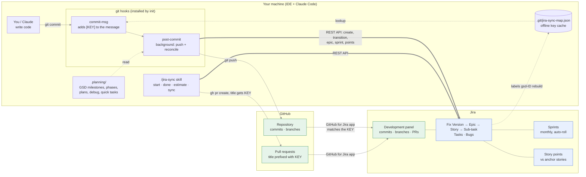
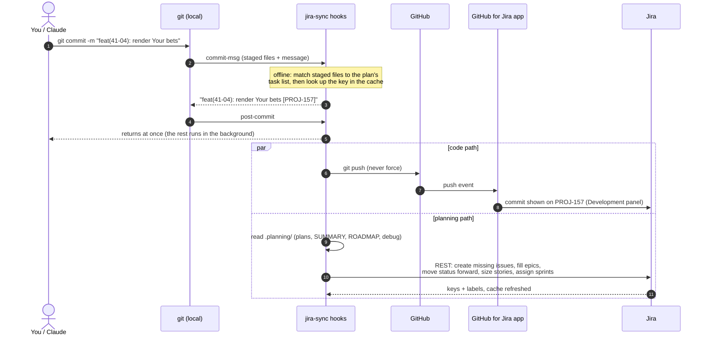
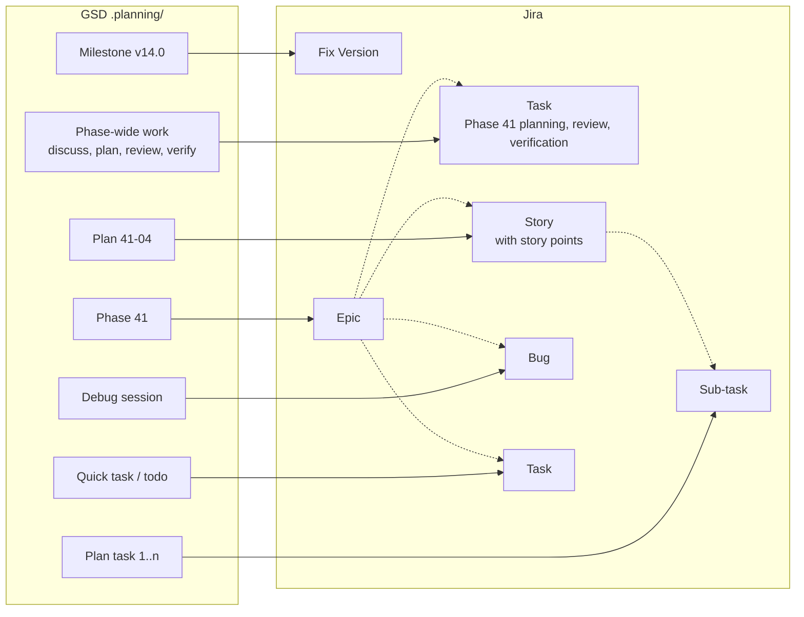

# jira-sync

A Claude Code plugin that keeps a Jira project in step with a git repo. Every commit lands on the right issue, sprints and epics stay filled in, and stories get story points. It understands GSD (Get Shit Done) planning files, and it also works in repos that don't use GSD.

It needs only the Python standard library, and nothing about a site, project or path is hardcoded. A repo opts in with one small config file.

## How it works

Two paths keep Jira current:

- **Planning and status** go straight from your machine to Jira's API (blue).
- **Code** (commits, branches, PRs) reaches Jira through GitHub and the **GitHub for Jira** app (green), which uses the issue key that jira-sync writes into every commit message and PR title.



### What happens on one commit



### Where a GSD item ends up

Solid arrows show what each GSD item becomes. Dotted arrows show the parent each issue sits under in Jira. Every Story, Task and Bug also goes into a sprint: the active one, or the one it finished in.



## What it does

| Area | Behaviour |
|---|---|
| **Commits** | A `commit-msg` hook appends ` [KEY]` for the most specific issue (see [Where commits land](#where-commits-land)). It works offline and never blocks a commit. |
| **Development panel** | With auto-push on, each commit is pushed in the background. The **GitHub for Jira** app then shows it on the issue within a minute or two. |
| **PRs** | After `gh pr create`, the PR title is prefixed with its issue key. |
| **GSD sync** | On every commit, `.planning/` is reconciled into Jira in the background. |
| **Sprints** | Every Story, Task and Bug sits in a sprint. Sprints run by calendar month and roll over automatically. |
| **Epics** | Every Story, Task and Bug has an Epic. |
| **Story points** | Fibonacci (1, 2, 3, 5, 8, 13) by relative estimation against fixed anchor stories, with a Claude review pass. |
| **Text** | Summaries are short titles (60 characters at most). Descriptions are sectioned and built from the source files. |
| **Non-GSD work** | `/jira-sync start "…"` picks Bug, Story, Task or Epic, reuses a matching open issue, files it under an Epic, puts it in the sprint and tags your commits. |

### GSD mapping

| GSD | Jira |
|---|---|
| milestone | Fix Version (released when the milestone is archived) |
| phase | Epic |
| phase-wide work: discussion, research, planning, review, verification | Task "Phase N planning, review and verification" |
| plan | Story |
| plan task | Sub-task |
| debug session | Bug |
| quick task / todo | Task |

- **Status** follows GSD's own files and only ever moves forward, so it never reopens something a person closed.
- **Unplanned work:** bugs, quick tasks and todos go under the Epic of the phase being worked on when they appeared. Open work goes under the current phase; past work is matched by date.

### Where commits land

First match wins:
1. A key already in the message.
2. A key in the branch name.
3. A GSD plan commit (`feat(41-04): …`) goes to the **Sub-task** whose `<files>` overlap the staged files most. If none matches, it goes to the plan's **Story**, which also gets the plan's `complete` commit.
4. A phase-wide commit (`docs(41): …`) goes to that phase's **planning/review/verification Task**.
5. `quick-…` goes to its Task.
6. Otherwise, the **current issue** set by `/jira-sync start`.

Commits never land on an Epic.

### Sprints

- **Where items go:**
  - Open work goes into the active sprint.
  - Finished work goes into the sprint whose dates cover when it finished, taken from git.
  - Work finished before the first sprint goes into "Sprint 0 (before Jira)". Team-managed boards allow only one active sprint, so it closes itself at the next rollover.
- **Rollover:** when the active sprint's end date passes, the next sync closes it, starts the next sprint (creating one if needed) and carries unfinished work over.

### Story points

- **Anchors:** 3 to 5 finished stories are fixed references for 1, 2, 3, 5 and 8 points, stored in `.jira-sync.json`. `/jira-sync anchors` proposes a set for you to approve.
- **Automatic first guess:** each story is scored on effort (the plan's estimate), complexity (files and tasks) and risk (human checkpoints, hands-on plans). It takes the nearer of the two anchors it falls between; a full step beyond the largest anchor gives 13. The reason is added as a comment, and points a person set are never overwritten.
- **`/jira-sync estimate`:** Claude reads each guessed story next to the anchors, asks the relative questions, and confirms or changes the number with a written reason.

## Install

```
/plugin marketplace add EchoSilo/jira-sync
/plugin install jira-sync@jira-sync
```

**Credentials:** create an API token at https://id.atlassian.com/manage-profile/security/api-tokens. They are read from the first of these that has them:
1. Environment variables: `JIRA_EMAIL` / `JIRA_API_TOKEN`. On Windows, `setx` works without a restart.
2. The repo's `.env` file. The values are read by the script and never printed.

**Links:** install **GitHub for Jira** on your Atlassian site. Connect your GitHub account and grant it access to the repo; private repos must be granted explicitly.

## Turn it on for a repo

```
/jira-sync init --site yoursite.atlassian.net --project KEY --auto-push on
/jira-sync doctor          # everything should read OK
/jira-sync anchors         # approve story-point anchors (GSD repos)
/jira-sync sync            # preview, then the first full sync
```

`init` writes `.jira-sync.json`; commit it. It also installs the `commit-msg` and `post-commit` git hooks, chaining any hooks you already have. On a new clone or a new machine, run `/jira-sync init` again.

## Commands

| Command | Does |
|---|---|
| `start "<work>"` | Find or create the issue, file it under an epic, put it in the sprint and make it current. Add `--branch` for a `KEY-slug` branch. |
| `done [KEY]` | Move to Done and clear the current issue. |
| `sync` | `reconcile --dry-run`, then `reconcile`. Add `--refresh-text` to rewrite every synced summary and description. |
| `epics` | List open epics. |
| `anchors [--accept \| --set ID=PTS,...]` | Show, approve or hand-pick story-point anchors. |
| `estimate [--set KEY=N --reason "..."]` | List automatic guesses, or record a reviewed estimate. |
| `status` / `doctor` | Current issue and recent sync log / a full setup check. |

## Files it keeps

| What | Where |
|---|---|
| Jira target, anchors, auto-push setting | `<repo>/.jira-sync.json` (committed) |
| GSD id → issue key | Jira labels `jira-sync` + `gsd-<id>`, the source of truth, so reruns never duplicate. A cache is kept in `.git/jira-sync-map.json` for the offline commit hook. |
| Current issue | `.git/jira-sync-active` |
| Background sync and push log | `.git/jira-sync.log` |
| Script used by git hooks | `~/.jira-sync/jira_sync.py`, refreshed from the plugin on every manual run |

## Test

```
python tests/test_jira_sync.py
```
